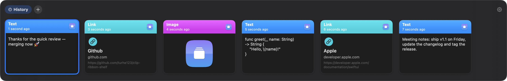
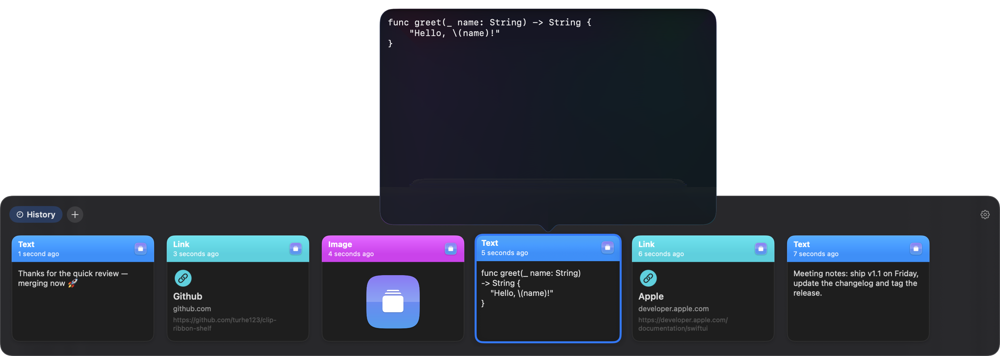
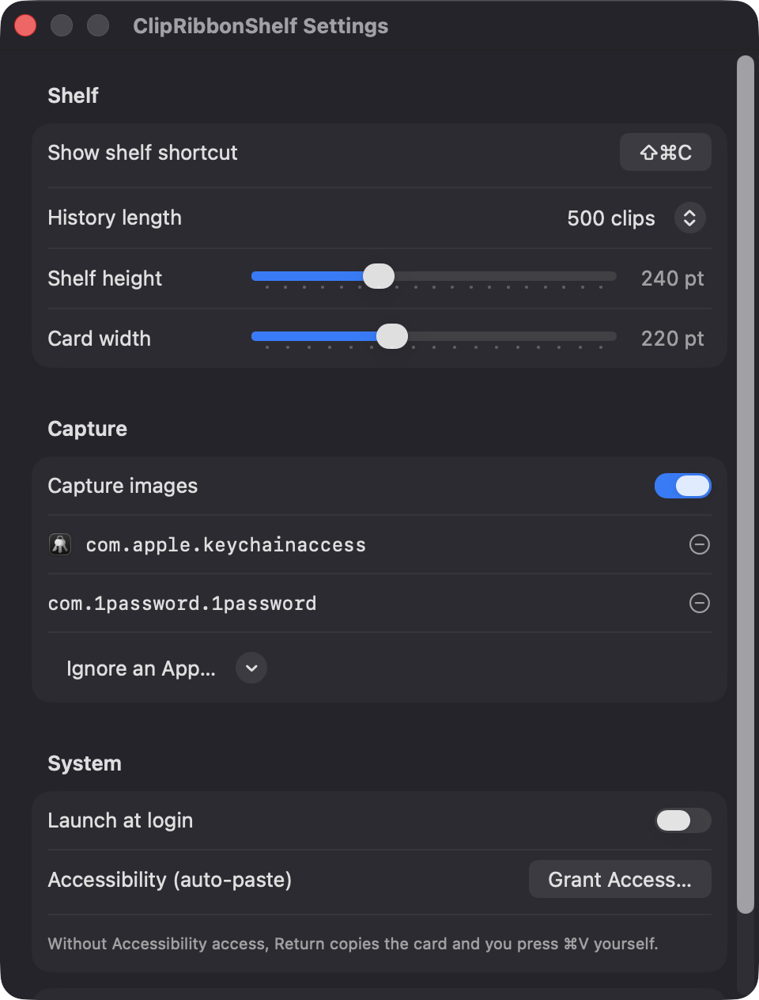

# ClipRibbonShelf

**🌐 Website:** [turhe123.github.io/clip-ribbon-shelf](https://turhe123.github.io/clip-ribbon-shelf/)

A visual strip of clipboard cards that slides up from the screen bottom with pinboards for saved clips.

> 🆓 A free, open-source **Paste alternative** for macOS 14+. Native Swift, no accounts, no subscriptions, MIT licensed.


## Why

ClipRibbonShelf is a free, open-source, 100% native, backend-free alternative to paid utilities in the *Clipboard* category. Visual clipboard managers such as Paste ($3.99/month) showed how pleasant a card-based history can be; this project brings a similar idea to everyone at no cost, with no account, no network access and no servers.

## Features

- **Clipboard history as cards** – captures text, links, images and file references from the general pasteboard (polled every 0.5 s).
- **Global hotkey** – default ⇧⌘C (rebindable in Settings) slides a translucent shelf up from the bottom of the screen that your mouse is on.
- **Type-aware previews** – wrapped text, image thumbnails, link title + host, and file icon + name. Each card shows the source app's icon and a relative time stamp.
- **Pinboards** – named collections shown as tabs above the cards. Create them with the **+** button, drag cards onto a tab, or press ⌘1–⌘9 to pin the selected card. Deleting a pinboard asks for confirmation and moves its cards back to History.
- **Keyboard-first** – ←/→ to move, Return to paste, Space for a Quick Look popover, Tab / ⇧Tab to switch tabs, Delete to remove a card, Esc to close, and just start typing to filter. ⌘, opens Settings.
- **Auto-paste** – Return writes the card to the pasteboard, returns to the previous app and sends ⌘V. Without Accessibility access, it copies and shows a toast asking you to press ⌘V.
- **Privacy-minded capture** – skips items flagged concealed/transient, ignores configurable apps (Keychain Access and 1Password by default), can pause capture from the menu bar, and can turn off image capture.
- **Local only** – link titles are derived from the URL host, so no network requests. History and pinboards are stored as JSON with image files in `~/Library/Application Support/ClipRibbonShelf`. Corrupt storage is backed up and reset. Images over 20 MB are skipped.
- **Settings** – history length (100 / 500 / 1000), shelf height, card width, ignored apps, image capture toggle, Launch at login.
- **Accessibility** – VoiceOver labels on cards and tabs, and a solid background when Reduce Transparency is on.
- **Menu bar app** – Show Shelf, Pause Capture, Settings, Support, Quit.

## Screenshots

<p align="center"></p>

<p align="center"><em>The clipboard shelf slides up from the bottom of the screen with color-coded cards for text, links, images and code.</em></p>

<p align="center"></p>

<p align="center"><em>Press Space on a selected card to open a Quick Look popover with its full contents.</em></p>

<p align="center"></p>

<p align="center"><em>Settings let you rebind the shortcut, set history length, shelf height and card width, and ignore apps such as password managers.</em></p>

## Install

1. Download `ClipRibbonShelf-macOS.zip` from <https://github.com/turhe123/clip-ribbon-shelf/releases/latest>.
2. Unzip it and move `ClipRibbonShelf.app` to `/Applications`.
3. The app is open source and not notarized, so clear the quarantine flag:

   ```bash
   xattr -cr /Applications/ClipRibbonShelf.app
   ```

4. Right-click the app → **Open** the first time.

## Build from source

Requires macOS 14+ and Xcode with Swift 5.9+.

```bash
brew install xcodegen
xcodegen generate
xcodebuild -project ClipRibbonShelf.xcodeproj -scheme ClipRibbonShelf -configuration Release -derivedDataPath ./build build
```

The app is produced at `build/Build/Products/Release/ClipRibbonShelf.app`.

## Permissions

- **Accessibility** – the only permission the app requests. It is needed to send ⌘V to the app you were using so a card is pasted directly. A first-run sheet explains this; you can decline and still use the app (cards are copied and you press ⌘V yourself).
- **Launch at login** (optional) – registered through `SMAppService`; macOS may show it under Login Items.

The app does not request Screen Recording, Microphone, Camera, or network access.

## Built with AI

ClipRibbonShelf was written by [Claude Code](https://claude.com/claude-code) inside an automated pipeline, from a plain-English spec. No code, binaries or assets from any commercial app were used; it is a clean-room reimplementation of a feature set, not a copy.

What that means in practice:

- The full source is in this repo under the MIT license. Read it before you run it.
- No network calls, no analytics, no third-party dependencies. Only Apple frameworks.
- Ad-hoc signed and not notarized, which is why Gatekeeper warns on first launch.
- It has had less human review than a hand-written app. Bug reports and pull requests are welcome.

## Support ❤️

If ClipRibbonShelf is useful to you, consider supporting development:

[Support Or (Leo) Davidai ❤️ on Ko-fi](https://ko-fi.com/leodavidai)

There is also a "Support / Donate ❤️" button in the menu bar and Settings.

## More free Mac apps

ClipRibbonShelf is one of [60 free, open-source Mac utilities](https://github.com/turhe123/mac-apps) built the same way: native Swift, no accounts, no telemetry. Browse the full gallery at [turhe123.github.io/mac-apps](https://turhe123.github.io/mac-apps/).

## License

MIT © Or Davidai Bachar
